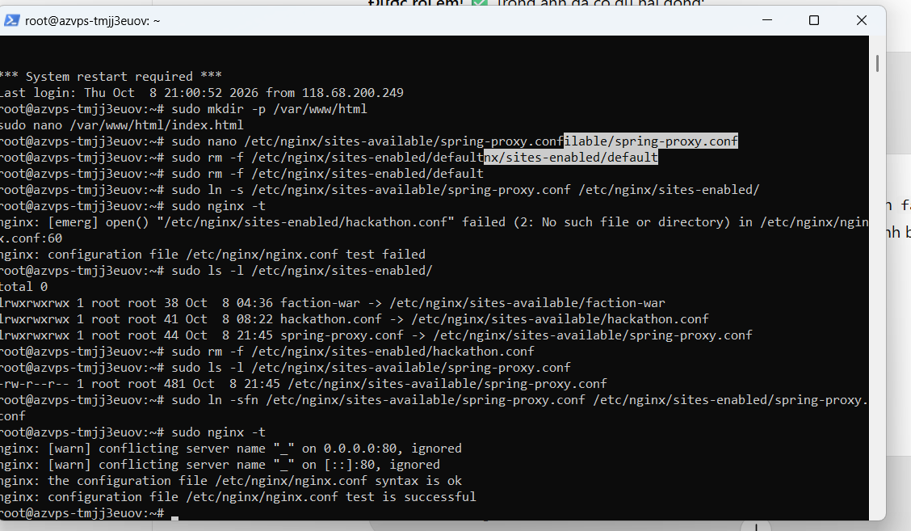
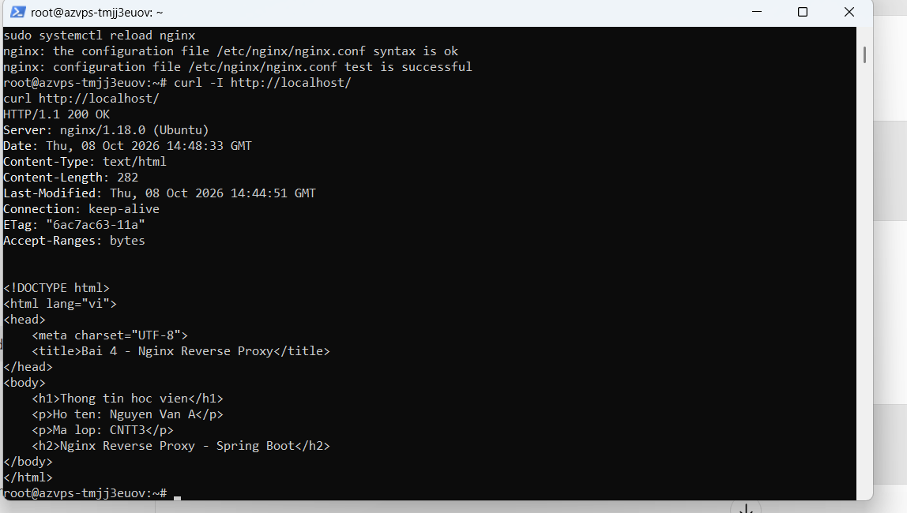

# Bài 4: Nginx Reverse Proxy cho Spring Boot

**Họ tên:** [Điền họ tên]  
**Mã lớp:** CNTT3

## Cấu hình

- File: `spring-proxy.conf`
- `/` → trang tĩnh tại `/var/www/html/`
- `/api/` → Spring Boot `http://127.0.0.1:8082/`
- Kích hoạt bằng symlink trong `sites-enabled`.

## Kiểm tra

```bash
sudo nginx -t
curl -I http://localhost/
curl -i http://localhost/api/health
```

**Kết quả đã quan sát:** `nginx -t` báo `syntax is ok`, `test is successful`; trang chủ trả nội dung HTML. `/api/health` trả HTTP 404 từ backend với đường dẫn `/health` (chưa có endpoint), **không phải lỗi 502**.

## Ảnh minh chứng

**Ảnh 1 – Kiểm tra cấu hình Nginx:**



**Ảnh 2 – Trang chủ HTTP 200 / nội dung HTML:**



**Ảnh 3 – Reverse Proxy `/api/health`:**

c:\Users\HP\OneDrive\Desktop\IT 214\Session07\Ex04\homework\session_07\ex4\img\anh3.png
